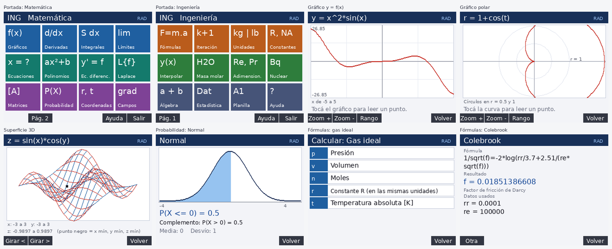

# ING — menú visual de ingeniería para HP Prime G2

**ING** es un programa para la calculadora **HP Prime G2** que reemplaza la navegación por menús de la calculadora con una portada de cuadros táctiles. Está pensado para cursar Ingeniería (con foco en química y nuclear): se elige un cuadro, se completa un formulario y se lee el resultado.

- Un solo archivo de texto, escrito en HP PPL (el lenguaje de la calculadora).
- Todo en español, con punto decimal.
- Versión actual: **1.1** → [`dist/ING_v1.1.txt`](dist/ING_v1.1.txt)



> Las imágenes salen del simulador de este repositorio (ver [Emulación](#cómo-emularlo)), no son capturas de la calculadora. En el equipo real los colores y la tipografía cambian un poco.

## Qué incluye

La portada tiene dos páginas de 12 cuadros.

### Página 1 — Matemática

| Cuadro | Qué hace |
|---|---|
| **Gráficos** | y = f(x) y polar r = f(t) con zoom, rango y lectura al tocar; superficie z = f(x,y) en malla de alambre; accesos a las apps Función, Gráfico 3D, Polar y Paramétrica. |
| **Derivadas** | df/dx, orden n, parciales de todas las variables, implícita dy/dx, puntos críticos, serie de Taylor. |
| **Integrales** | Indefinida, definida (también impropia), doble, triple, de línea o cerrada F·dr. |
| **Límites** | Una variable (a un valor o a ±infinito) y dos variables por caminos. |
| **Ecuaciones** | Despejar una variable, resolver con números, inecuaciones, sistemas, soluciones complejas. |
| **Polinomios** | Raíces reales y complejas de cualquier grado, a partir de los coeficientes. |
| **Ec. diferenciales** | Solución general, con condiciones iniciales (cualquier orden, simbólica) y numérica y' = f(x,y) por Runge-Kutta 4. |
| **Laplace** | Transformada, inversa y fracciones parciales de F(s). |
| **Matrices** | Editar A y B; determinante, inversa, transpuesta, rango y traza, A±B, A·B, k·A, Aⁿ, A·x = B, autovalores, forma escalonada. Cualquier tamaño. |
| **Probabilidad** | Normal, t de Student, chi cuadrado, F, exponencial, uniforme, binomial, Poisson, geométrica e hipergeométrica: P(X ≤ a), P(X ≥ a), P(a ≤ X ≤ b), valor exacto y cuantil, con el gráfico sombreado, media y desvío. |
| **Coordenadas** | Cartesianas ↔ polares, cilíndricas y esféricas; gráfico polar; pasar una ecuación cartesiana a polar. |
| **Campos** | Gradiente, divergencia, rotor, laplaciano, hessiano, derivada direccional. |

### Página 2 — Ingeniería

| Cuadro | Qué hace |
|---|---|
| **Fórmulas** | 144 fórmulas por materia (termodinámica, cinética y reactores, fluidos, calor, masa y separación, química, nuclear, adimensionales, control). Se elige **cuál variable calcular** y se cargan las demás: despeja cualquiera, aunque no se pueda a mano. También se guardan fórmulas propias. |
| **Iteración** | Punto fijo, Newton-Raphson y bisección, mostrando cada paso. |
| **Unidades** | 148 unidades en 25 magnitudes (incluye actividad, dosis y exposición). |
| **Constantes** | R en varios sistemas de unidades, Avogadro, Boltzmann, Faraday, Planck, etc. |
| **Interpolar** | Lineal entre dos puntos y doble para tablas de dos entradas. |
| **Masa molar** | Fórmulas con paréntesis e hidratos; muestra la composición porcentual. |
| **Adimension.** | Reynolds, Prandtl, Nusselt y el resto, como fórmulas despejables. |
| **Nuclear** | Decaimiento, actividad, blindaje, densidad atómica, reactividad y otras. |
| **Álgebra** | Simplificar, factorizar, expandir, fracciones parciales, evaluar, sumatorias. |
| **Estadística** | Accesos a las apps de 1 variable, 2 variables e Inferencia. |
| **Planilla** | Abre la app Hoja de cálculo de la calculadora. |
| **Ayuda** | Instrucciones, autoprueba (**Prueba**) y modo diagnóstico (**Diagn.**). |

## Instalación en la calculadora

Hace falta el [HP Connectivity Kit](https://www.hpcalc.org/prime/pc) (Windows o macOS, gratuito) y el cable USB.

1. Conectar la calculadora y abrir el Connectivity Kit. La calculadora aparece en el panel izquierdo.
2. Clic derecho en **Programas → Nuevo** y ponerle de nombre `ING`.
3. Abrir [`dist/ING_v1.1.txt`](dist/ING_v1.1.txt), seleccionar todo, copiar y pegar en el editor del programa (reemplazando lo que haya). Guardar: se envía solo a la calculadora.
4. En la calculadora: `Shift` + `1` (Programa) → `ING` → **Comprobar**. Tiene que decir que no hay errores.
5. Ejecutarlo: desde ese catálogo con **Ejecutar**, o desde `Toolbox → Usuario → ING`.

Para no pasar por el catálogo cada vez (tecla directa o ícono en Apps), ver [`docs/ACCESO_RAPIDO.md`](docs/ACCESO_RAPIDO.md).

Recomendado la primera vez: entrar a **Ayuda → Prueba**. Muestra, renglón por renglón, si responden las funciones de la calculadora que usa el programa (CAS, distribuciones, reloj).

### Ajustes de la calculadora que espera el programa

- Separador decimal: **punto** (ajuste de fábrica).
- Formato de número: **Estándar**.
- El modo de ángulo (RAD/DEG) se respeta y se muestra arriba a la derecha. Derivadas, integrales y límites usan el ajuste de ángulo del CAS.

## Cómo se usa

- **Tocar** un cuadro o un renglón para entrar. `Esc` o el botón **Volver** llevan a la pantalla anterior.
- Las teclas `1` a `7` eligen un renglón del menú; las flechas cambian de página.
- Las funciones se escriben con las teclas normales, en mayúsculas o minúsculas: `x^2*sin(x)`, `sqrt(x)`, `exp(x)`, `ln(x)`, `pi`. Multiplicar siempre con `*`. `log` es base 10. Infinito: `inf`.
- Matrices: A es `M1`, B es `M2` y el resultado queda en `M3`, disponibles después desde Inicio.
- Fórmulas: usan las variables A a N, X e Y de Inicio como memoria de trabajo. Las fórmulas propias se guardan en la variable `INGF`.
- Los botones que abren una app de la calculadora (Función, Gráfico 3D, Hoja de cálculo, Estadística) salen de ING; para volver se ejecuta `ING` otra vez.

Si algo falla, **Ayuda → Diagn.** activa el modo diagnóstico: el error se muestra con su número de renglón, que es lo que hace falta para reportarlo.

## Cómo emularlo

Hay dos maneras, y sirven para cosas distintas. El detalle está en [`docs/EMULACION.md`](docs/EMULACION.md).

| | Emulador oficial de HP | Simulador de este repositorio |
|---|---|---|
| Qué es | **HP Prime Virtual Calculator** (Windows y macOS): el mismo firmware de la calculadora. | Un traductor de PPL a Python con una pantalla de 320×240 dibujada con Pillow. |
| Para qué sirve | Probar el programa de verdad, incluido el CAS. | Verificar el formato del código y recorrer las pantallas automáticamente antes de pasarlo a la calculadora. |
| CAS (derivadas, integrales…) | Sí | No: solo registra el comando que se enviaría. |
| Uso | Interactivo | Por guiones (toques, teclas, respuestas de formularios) y recorridas al azar. |

Resumen rápido del emulador oficial (Windows):

```
winget install --id=HP.PrimeVirtualCalculator -e
```

Abrirlo, `Shift` + `1` → **Nuevo** → nombre `ING`, pegar el contenido de `dist/ING_v1.1.txt` (menú *Edit → Paste*), **Comprobar** y ejecutar.

Resumen rápido del simulador:

```
pip install pillow numpy scipy
tools/test.sh
```

## Desarrollo

El archivo de entrega se **genera**; no se edita a mano. El código fuente está partido en ocho archivos en `src/`.

```
src/        código fuente PPL (p1_base … p8_main)
tools/      build.sh (une y verifica), wrap.py, audit.py, test.sh
sim/        traductor PPL → Python, calculadora simulada y pruebas
dist/       archivo listo para pegar en la calculadora (CRLF)
docs/       guía de emulación, acceso rápido e imágenes
extras/     programas opcionales (tecla directa, app con ícono) — sin probar en el equipo
AGENTS.md   contexto y reglas del proyecto para asistentes de IA (Claude, Codex)
```

```
tools/build.sh        # une src/ → dist/ING_v<VERSION>.txt y lo pasa por el analizador estricto
tools/test.sh         # build + auditoría de formato + todas las pruebas + recorridas al azar
```

La HP Prime es muy estricta con el formato. Las reglas que sigue este código (nombres, largo de las listas `LOCAL`, funciones de texto con casos límite, etc.) están en [`AGENTS.md`](AGENTS.md); `tools/build.sh` falla si alguna no se cumple.

## Límites conocidos

- Es un programa del catálogo, no una app con ícono propio.
- Planilla y Estadística abren las apps nativas de la calculadora (se sale de ING).
- Los límites de dos variables se calculan por caminos: sirven para detectar que un límite no existe, no para demostrar que existe.
- La solución numérica de ecuaciones diferenciales es solo de primer orden (las de orden mayor se resuelven en forma simbólica).
- Las matrices son numéricas.
- Los resultados simbólicos dependen del CAS de la calculadora; el simulador de este repositorio no los verifica.

## Historial

Ver [`CHANGELOG.md`](CHANGELOG.md).

---

HP y HP Prime son marcas de HP Inc. Este proyecto no tiene relación con HP.
